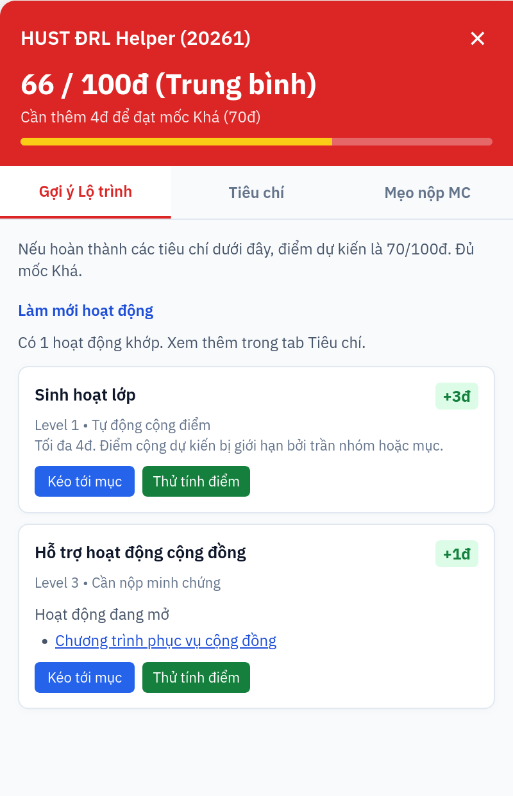

# HUST ĐRL Helper

HUST ĐRL Helper là tiện ích trình duyệt giúp sinh viên Đại học Bách khoa Hà Nội theo dõi Điểm Rèn Luyện (ĐRL), lập kế hoạch đạt mốc xếp loại và tìm hoạt động phù hợp ngay trên iCTSV. Bộ tiêu chí mẫu đi kèm dành cho kỳ 2026.1.

## Cài đặt

Tải mã nguồn bằng **Code → Download ZIP** và giải nén vào một thư mục. Bạn cũng có thể tải gói cài đặt nếu có bản phát hành. [Releases](https://github.com/aquistusfami/hust-drl-extension/releases)

| Trình duyệt | Cách nạp tiện ích |
| --- | --- |
| Chrome | Mở `chrome://extensions/`, bật **Developer mode**, chọn **Load unpacked**, rồi chọn thư mục chứa `manifest.json`. |
| Edge | Mở `edge://extensions/`, bật **Developer mode**, chọn **Load unpacked**, rồi chọn thư mục chứa `manifest.json`. |
| Firefox | Mở `about:debugging#/runtime/this-firefox`, chọn **Load Temporary Add-on…**, rồi mở tệp `manifest.json`. Firefox gỡ tiện ích tạm thời khi đóng trình duyệt. |

## Sử dụng

1. Đăng nhập iCTSV, mở trang chấm điểm và nhấn nút **HUST ĐRL** ở góc dưới bên phải. [Trang chấm điểm rèn luyện](https://ctsv.hust.edu.vn/cham-diem-ren-luyen)
2. Trong tab **Gợi ý Lộ trình**, xem điểm hiện tại, số điểm dự kiến và phần còn thiếu để đạt mốc tiếp theo **Khá (70 điểm)**, **Giỏi (80 điểm)** hoặc **Xuất sắc (90 điểm)**. Điểm cộng dự kiến tính theo trần của từng nhóm và mục.
3. Chọn **Tìm hoạt động đang mở**. Tiện ích tra cứu mục **Sự kiện** trên trang chủ iCTSV và đặt liên kết dưới tiêu chí tương ứng trong **Gợi ý Lộ trình** và **Tiêu chí**. Kết quả gồm những sự kiện được giới thiệu tại đó có nút **Đăng ký tham gia** trên trang chi tiết.
4. Chọn **Thử tính điểm** để mô phỏng điểm khi hoàn thành một tiêu chí. Dùng **Kéo tới mục** để xem tiêu chí trên trang chấm điểm hoặc mở **Mẹo nộp MC** để xem gợi ý chuẩn bị minh chứng.

Bạn có thể bật hoặc tắt widget bằng công tắc **Bật Widget trên iCTSV** trong popup của tiện ích.

## Demo

Widget trên Firefox với dữ liệu giả lập. Hai tiêu chí được gợi ý để tăng từ 66 lên 70 điểm, trong đó một tiêu chí có hoạt động đang mở.

## Dữ liệu và quyền riêng tư

Tiện ích tính điểm trong trình duyệt và lưu cục bộ dữ liệu dùng để tính điểm, lựa chọn mô phỏng và tùy chọn hiển thị. Khi tra cứu hoạt động, tiện ích đọc nội dung iCTSV hiển thị trong phiên hiện tại. Hãy đối chiếu kết quả chính thức và trạng thái minh chứng trên iCTSV.

## Đóng góp

Bạn có thể báo lỗi hoặc đề xuất tính năng trên [GitHub Issues](https://github.com/aquistusfami/hust-drl-extension/issues). Các bước thiết lập môi trường, kiểm thử và gửi pull request có trong [hướng dẫn đóng góp](CONTRIBUTING.md). Xem các thay đổi theo phiên bản trong [nhật ký thay đổi](CHANGELOG.md).
